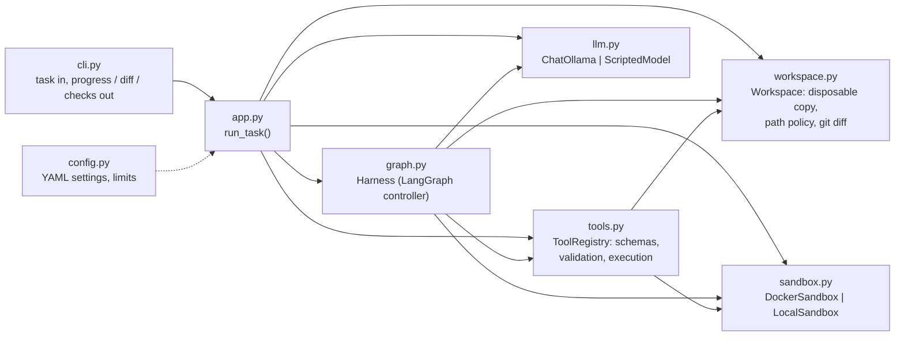
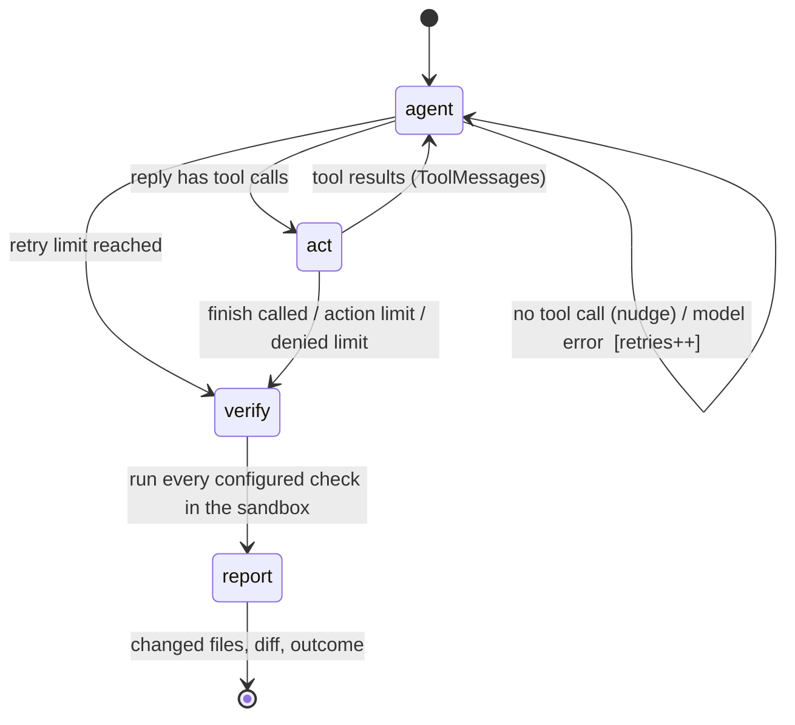
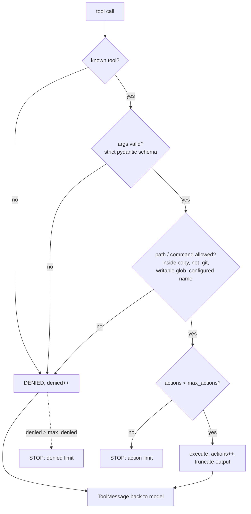

# Coding Harness — Stage 1 (LangGraph)

A small coding-agent harness: it takes a bug-fix task, lets an LLM (local Ollama) change a
**disposable copy** of a repository through validated tools, runs the tests in a sandbox, and
shows the changed files, the diff and the check results. The final checks are always run by the
harness itself, so a model that *says* it is done but breaks things is reported as failed.

## Setup

Requirements: Python 3.11+, git, [Ollama](https://ollama.com), and a container engine for the
contained sandbox: Docker or Podman, installed natively or inside WSL (the harness finds it
automatically). Without one, add `--sandbox local` to the commands below.

```powershell
git clone --recurse-submodules <this-repo-url>
cd <repo>
scripts\setup.ps1                  # Linux/macOS: sh scripts/setup.sh
```

The setup script can be re-run safely. It:
1. creates `.venv` and installs the harness (`pip install -e ".[dev]"`)
2. checks out the target submodule `targets/cosmicpython` at the recorded commit `14c8479`
3. creates the target's test environment `targets/.venv-cosmic` (used by `--sandbox local`)
4. builds the sandbox image `coding-harness-cosmic` (`harness build-image`) with the first engine that
   works: `docker`, `podman`, `wsl docker`, `wsl podman`
5. pulls the model `qwen2.5-coder:14b` (if Ollama is installed)
6. runs the test suite (no model needed)

Options: `-SkipDocker`, `-Model qwen2.5-coder:7b` (sh: `SKIP_DOCKER=1`, `MODEL=...`).

## Usage

```powershell
# Show that the acceptance check fails on the starting code
.venv\Scripts\harness baseline --config examples/cosmic/harness.yaml

# Let the harness fix it
.venv\Scripts\harness run --config examples/cosmic/harness.yaml --task-file examples/cosmic/task.md

# Smaller live-demo task, and the controller graph as Mermaid
.venv\Scripts\harness run --config examples/cosmic-demo/harness.yaml --task-file examples/cosmic-demo/task.md
.venv\Scripts\harness graph

# Tests (no model, no network, no API key)
.venv\Scripts\python -m pytest
```

Both example configs use the **container** backend (contained). `--sandbox local` switches to the
local backend for machines without a container engine. Force a specific engine with
`HARNESS_CONTAINER_ENGINE=wsl docker` (or `docker`, `podman`, `wsl podman`). Override the model with `HARNESS_MODEL` and the Ollama
URL with `OLLAMA_HOST` (see `.env.example`; no secrets are needed).

Each run writes `runs/<id>/` containing `workspace/` (the changed copy), `checks/`,
`diff.patch`, `report.json` and `events.jsonl` (every model reply, action, denial and check).
The process exits with code 0 only when the outcome is `success`.

## Architecture



| Part | Where | What it does |
|---|---|---|
| Setup | `pyproject.toml`, `scripts/setup.*`, `.gitmodules`, `sandbox/Dockerfile.cosmic`, `examples/*/harness.yaml` | dependencies, target + sandbox image, example settings without secrets |
| Interface | `cli.py` | `harness run` / `harness baseline`; live progress, changed files, diff, check table |
| Controller | `graph.py` | LangGraph state machine: model ↔ tools loop, limits, final checks, report |
| Repository tools | `tools.py`, `workspace.py` | `list_files`, `read_file`, `search`, `edit_file`, `write_file` inside the copy only |
| Execution | `sandbox.py`, `tools.run_command` | configured commands only; output + exit code captured; timeout kills the whole process tree |
| Limits | `config.LimitSettings`, `graph.act/agent`, `limits.truncate` | action / denied / retry limits; bounded, visibly truncated output |
| Verification | `graph.verify`, `graph.report` | acceptance + regression checks always run; outcome derived from checks, not from the model |

### Control loop (LangGraph)



`act` handles every tool call of a reply in order:



### Outcomes

| Outcome | Meaning |
|---|---|
| `success` | model called `finish` **and** every check passed |
| `checks_failed` | model finished, but at least one check failed, timed out or was unavailable |
| `stopped` | the harness stopped the loop (action / denied / retry limit); checks still ran |
| `incomplete` | the loop ended without `finish` |
| `unverified` | no checks configured — never reported as success |

## Protecting the working environment

* **Disposable copy.** The target is exported at the exact recorded commit (`git archive`) into
  `runs/<id>/workspace`, with a fresh, remote-less git repo used only for the diff. There is no
  git tool, no remote, so push/merge/deploy are impossible.
* **File scope in application code.** Every path goes through `Workspace.resolve`: absolute paths,
  `~`, `..` escapes, symlinks leaving the copy and `.git` are rejected; writes must also match the
  task's `writable` globs (here only `model.py`, `handlers.py`, `tests/unit/*.py`).
* **Acceptance check outside the writable area.** `examples/cosmic/acceptance/` is copied to
  `runs/<id>/checks/` (outside the workspace; mounted read-only in Docker). It defines its own fakes,
  so editing repository tests cannot influence it. A pristine copy of the original unit tests from
  the starting commit is run as a regression check as well.
* **Commands.** The model can only run commands configured by name (`run_command name=unit_tests`),
  optionally with a target path that must lie inside the copy. Model and repository text are
  treated as untrusted input.
* **Container backend (contained):** Docker or Podman, native or inside WSL (Windows paths are
  translated to `/mnt/<drive>/...`). `--network none`, `--read-only` root FS, `--cap-drop ALL`,
  `no-new-privileges`, only workspace (rw) and checks (ro) mounted; on timeout the container is
  killed. Memory/CPU/PID limits are applied with Docker. Rootless Podman without cgroup delegation
  (e.g. in WSL) cannot apply them, so `resource_limits: auto` turns them off there and the run header
  says `resource limits OFF`; the per-command timeout still applies.
* **Local backend (fallback, not a security boundary):** environment scrubbed to an allow-list
  (no API keys/tokens inherited), temp HOME, cwd = workspace. Every descendant process is tracked
  while the command runs and killed on timeout *and* after the command exits (Windows Job Object +
  `psutil`, POSIX process group), so a stuck command leaves no child processes or late writes
  behind. The CLI prints a warning when this backend is used.

## The task (acceptance check)

| | |
|---|---|
| Target | [cosmicpython/code](https://github.com/cosmicpython/code) — allocation service (domain model, service layer, message bus, unit of work) |
| Starting commit | `14c84797ffa77255d53cf1a02fe6aafda2b68aeb` |
| Request | `examples/cosmic/task.md` — `ChangeBatchQuantity` must raise `handlers.InvalidBatchRef` for unknown batch refs (instead of `AttributeError`) and `model.InvalidQuantity` for negative quantities, without changing any state |
| May change | `src/allocation/domain/model.py`, `src/allocation/service_layer/handlers.py`, `tests/unit/*.py` |
| Acceptance check | `examples/cosmic/acceptance/test_acceptance_change_batch_quantity.py` (through the message bus, across the handler and domain modules) |
| Regression | original `tests/unit` from the starting commit + `tests/unit` in the workspace |

On the starting code `harness baseline` reports `acceptance FAILED` (3 of 4 tests fail) and both
regression checks `PASSED`. `tests/test_cosmic_e2e.py` replays a scripted reference fix and shows
the acceptance check passing afterwards.

## Tests

All core tests use `ScriptedModel` (pre-written replies) — no model, network or key.

| Requirement | Tests |
|---|---|
| File tools: read / search / edit; reject outside paths | `tests/test_file_tools.py` |
| Controller: scripted reply calls the right tool and gets its result | `tests/test_controller.py` |
| Invalid request: unknown tool / bad args → clear error, nothing executed | `tests/test_invalid_request.py` |
| Failed command: nonzero exit stays visible, no false "passed" | `tests/test_failed_command.py` |
| Action limit: repeating reply stops at the limit | `tests/test_limits.py::test_repeating_reply_hits_action_limit` |
| Output limit: large output bounded and marked | `tests/test_limits.py` (`*_bounded`, `test_truncate_*`) |
| Bug fix: acceptance fails before, passes after, existing tests pass | `tests/test_bugfix.py` (sample repo), `tests/test_cosmic_e2e.py` (Cosmic Python) |
| Sandbox: secrets not inherited, stuck process tree killed, no late writes | `tests/test_sandbox.py` |
| Container: network blocked, only workspace writable, stuck command killed, red→green in container | `tests/test_container.py` (needs an engine + image) |

## Configuration reference

See `examples/cosmic/harness.yaml`: `model`, `target` (repo, commit, writable globs), `sandbox`
(backend, image, interpreter, env), `commands` (what the agent may run), `checks` (what the harness
always runs; placeholders `{python}`, `{checks}`, `{workspace}`), `checks_dir`, `baseline_copy`, `limits`.

## Demo run with a real model

_Fill in after recording:_ model and version used, run id, outcome, and any manual help
(e.g. restarting a run, changing the prompt, raising `max_actions`).
