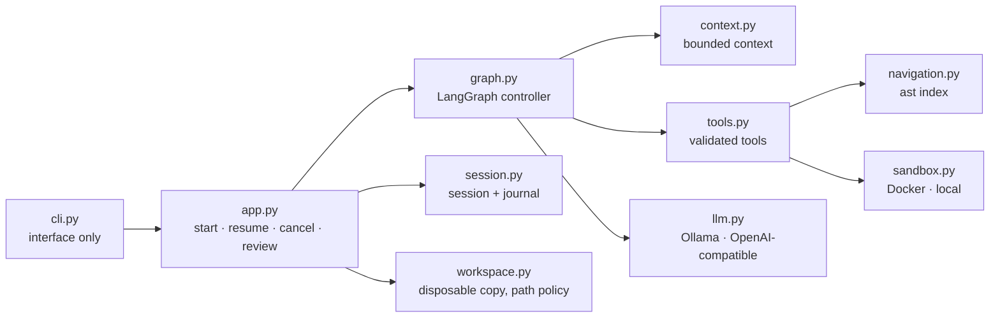
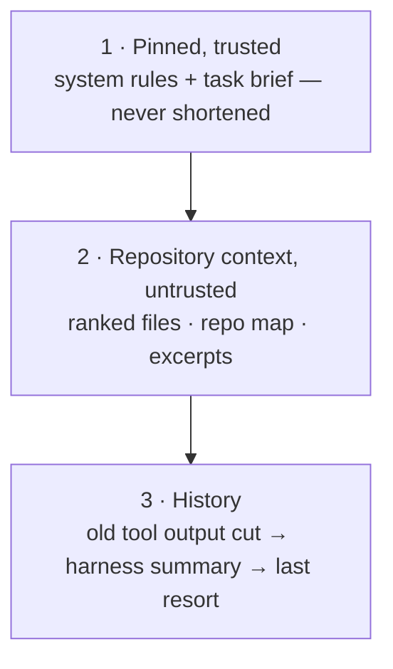
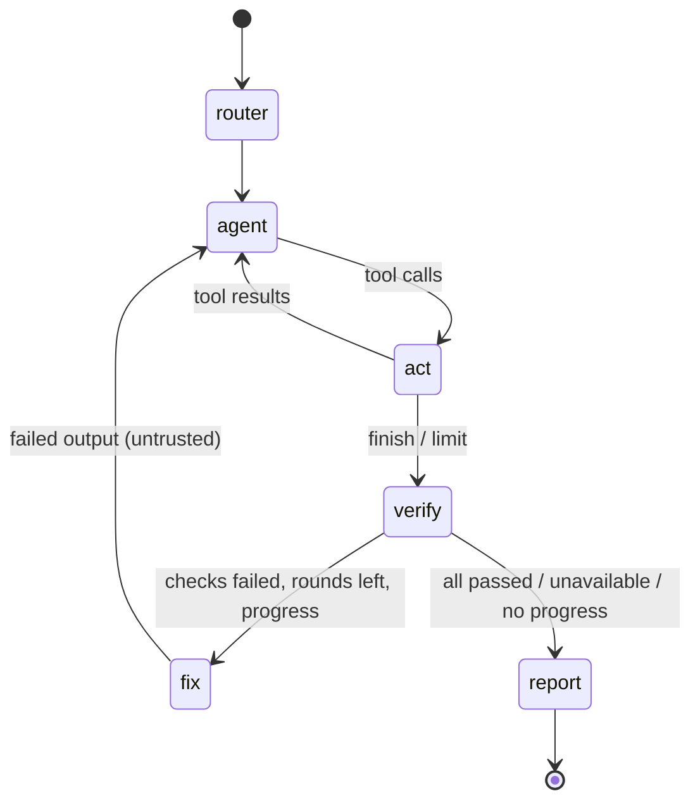

# Coding Harness — Stage 2

A capable coding harness in Python on **LangGraph**

Delivery 2 · cross-module feature · bounded context · saved sessions

---

## Scene 1 — Requirements and where they live

| Part | Implementation |
|---|---|
| Navigation | `navigation.py` — `ast` index + read-only Git tools |
| Context | `context.py` — repo map, ranked files, size-limited history |
| Task execution | `graph.py` — edit–test–fix loop, bounded rounds |
| Sessions | `session.py` — journal, checkpoints, cancel, safe resume |
| Verification | harness-run test · lint · build checks, `harness review` |
| CLI | `cli.py` — interface only, calls `app.py` |

---

## Scene 2 — Architecture



---

## Scene 3 — Navigation

| Tool | Example result |
|---|---|
| `find_symbol` | `model.py:33: method Product.change_batch_quantity(...)` |
| `find_references` | `bootstrap.py:35: [use] handlers.COMMAND_HANDLERS.items()` |
| `module_deps` | `handlers.py` imports `commands`, `events`, `model` |
| `repo_map` | `model.py: class Product(allocate, ...); class OrderLine` |
| `git_status`, `git_diff` | read-only: baseline commit, changed files |

- Parsed with `ast` — no import, no execution

---

## Scene 4 — Bounded context



- Limit: `context.max_chars` (feature config 60 000 ≈ 15k tokens)
- Repository text and tool output wrapped in `<<<UNTRUSTED … >>>`

---

## Scene 5 — Edit–test–fix loop



- Outcome comes from the checks — `unverified` is never `success`

---

## Scene 6 — Cancel and safe resume

```text
status cancelled   outcome -
start commit 14c84797ffa7…
actions 0/40   denied 0/6   retries 0/3   fix rounds 0/3
cancelled by user during model request (reply will be discarded)
```

- Write-ahead journal: every action saved before and after it runs
- Resume keeps used limits, rechecks permissions and the working-copy fingerprint
- Mismatch or uncertain action → **pause**, never replayed

---

## Scene 7 — Protecting the environment

| | |
|---|---|
| Copy | `git archive` at the recorded commit, no remote |
| Container | `--network none`, read-only root, `--cap-drop ALL`, limits |
| Checks | outside the writable area, mounted read-only |
| Permissions | path policy + pydantic schemas in application code |
| Secrets | API key never reaches executed code |

---

## Scene 8 — The feature and its acceptance check

| | |
|---|---|
| Target | cosmicpython/code, pinned commit `14c8479` |
| Request | `Deallocate` command, `Product.deallocate`, `NotAllocated` error |
| Modules | `commands.py`, `model.py`, `handlers.py` — not named in the task |
| Starting code | `harness baseline`: 5 of 6 feature tests fail, missing `Deallocate` |
| Also | regression (3×), new lint warnings, byte-compile |

---

## Scene 9 — Real model run: `harness review`

```text
Status: completed   outcome: success   start commit: 14c84797…
Changed files: commands.py  model.py  handlers.py  tests/unit/test_handlers.py

check                                 type   status  exit
acceptance (feature)                  test   PASSED  0
regression (original unit tests)      test   PASSED  0
regression (unit tests in workspace)  test   PASSED  0
regression (integration, sqlite)      test   PASSED  0
lint (new pyflakes warnings)          lint   PASSED  0
build (byte-compile)                  build  PASSED  0
```

- Qwen3.6-35B-A3B (FH endpoint) · 28 actions · ~75 s · 0 fix rounds
- Manual help: **none during the run** — task, allowed changes and checks written beforehand

---

## Scene 10 — Tests

| Requirement | Test file |
|---|---|
| Navigation · Context | `test_navigation.py` · `test_context.py` |
| Session storage | `test_session_storage.py` (new process) |
| Cancellation · Resume | `test_cancellation.py` · `test_resume.py` |
| Checks and loop | `test_fix_loop.py` (scripted replies) |
| Feature | `test_cosmic_feature.py` |
| Stage 1 | unchanged Stage 1 tests |

- `python -m pytest` — no model, no API key, no network
